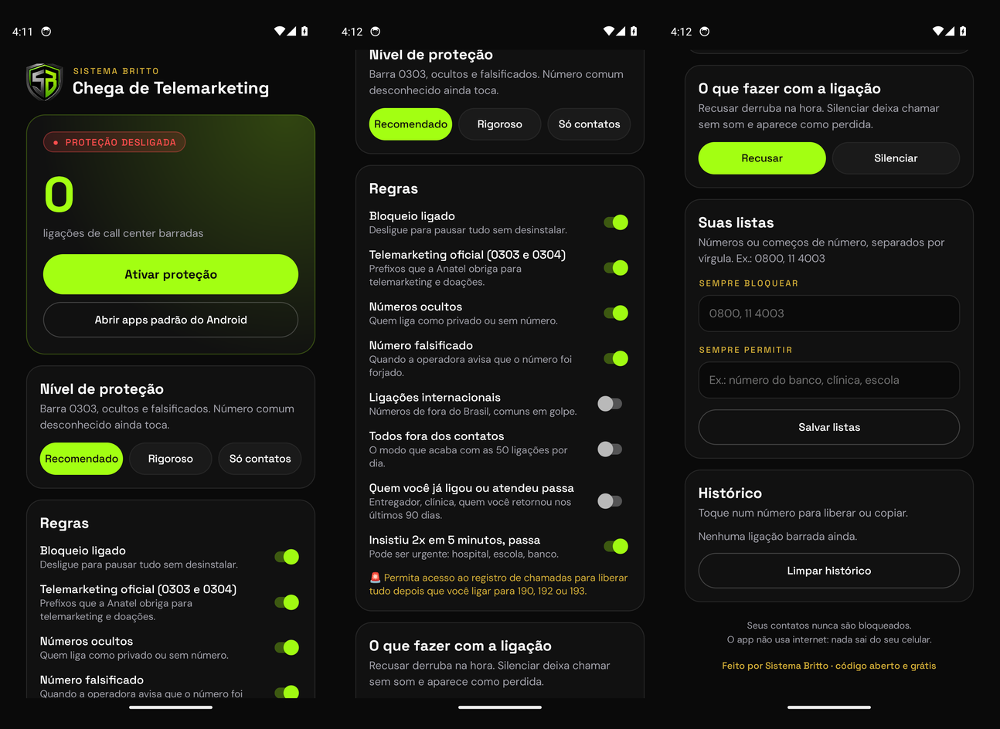

<p align="center">
  
</p>

<h1 align="center">📵 Chega de Telemarketing</h1>

<p align="center">
  <strong>App Android grátis e de código aberto que recusa sozinho as ligações de call center.</strong><br>
  Sem modo avião, sem perder os dados móveis. A ligação nem toca.<br>
  <sub>Um projeto <a href="https://sistemabritto.com.br">Sistema Britto</a> 🇧🇷</sub>
</p>

<p align="center">
  <a href="../../releases/latest"></a>
</p>

<p align="center">
  
</p>

## ⬇️ Baixar

👉 **[Baixar o APK mais recente](../../releases/latest)** — Android 10 ou mais novo (pensado no Samsung Galaxy A15 / One UI).

## O que ele faz

**Três níveis prontos**, um toque:

| Nível | O que toca |
|---|---|
| **Recomendado** | Tudo, menos 0303/0304, ocultos e números falsificados |
| **Rigoroso** | Só contatos e quem você já ligou |
| **Só contatos** | Só quem está na sua agenda |

**Regras** (dá para ligar e desligar uma por uma):

- 📞 **Telemarketing oficial** — prefixos **0303** (telemarketing) e **0304** (doações) da Anatel.
- 🙈 **Números ocultos / privados.**
- 🎭 **Número falsificado** — quando a operadora sinaliza que o número exibido foi forjado (Android 11+, depende da operadora).
- 🌎 **Internacionais** — números de fora do Brasil, muito usados em golpe.
- 🚫 **Todos fora dos contatos** — o modo que acaba com as 50 ligações por dia.
- ✅ **Quem você já ligou passa** — clínica, entregador, quem você retornou nos últimos 90 dias. (Ligação recebida e atendida não conta: atender um call center uma vez não libera ele.)
- 🔁 **Insistiu 2x em 5 minutos, passa** — opcional, para quem prefere não perder urgência (desligado no Rigoroso).
- 🚨 **Emergência** — depois que você liga para 190, 192 ou 193, **tudo passa por 1 hora**, até número oculto.
- 📝 **Suas listas** — "sempre bloquear" e "sempre permitir" por número ou começo de número (ex.: `0800`, `11 4003`).
- 🔇 **Recusar ou só silenciar** — silenciar deixa chamar sem som e a ligação aparece como perdida.
- 📜 **Histórico com motivo** — toda ligação aparece: se **tocou** ou foi **barrada**, e por quê. Toque num número para liberar ou bloquear.

E sempre:

- 👥 Quem está nos seus **contatos nunca é bloqueado**.
- 🔒 **Sem permissão de internet**: nada sai do seu celular. Confira no [`AndroidManifest.xml`](app/src/main/AndroidManifest.xml).

## Como instalar

1. Baixe o `.apk` em [Releases](../../releases/latest) pelo celular.
2. Toque no arquivo e permita **instalar apps desta fonte** (Chrome ou Meus Arquivos).
   - Se o Play Protect avisar: **Mais detalhes → Instalar mesmo assim** (acontece com todo app fora da Play Store).
3. Abra o app e toque em **Ativar proteção** → escolha **Chega de Telemarketing** como **app de ID de chamadas e spam**.
4. Permita **Contatos** e **Registro de chamadas** (é o que garante que conhecido nunca seja bloqueado).
5. Escolha o nível. Para acabar de vez com call center: **Rigoroso**.

### Tocou e não devia?

Abra o app e olhe o **Histórico**: cada ligação mostra o motivo de ter passado (ex.: *"Você ligou para este número nos últimos 90 dias"*). Se o histórico estiver vazio, o app não está ativado como app de ID de chamadas e spam.

### Samsung (Galaxy A15 e outros)

Se o botão Ativar não abrir nada:
**Configurações → Aplicativos → Escolher apps padrão → App de ID de chamadas e spam → Chega de Telemarketing**
(o botão **Abrir apps padrão do Android** leva direto para lá).

## Dicas extras (grátis)

- Cadastre seu número no **[Não Me Perturbe](https://www.naomeperturbe.com.br)** — cadastro oficial das operadoras e bancos para não receber oferta por telefone.
- Reclame na **Anatel** (app *Anatel Consumidor* ou 1331) quando uma empresa insistir.

## Projetos parecidos

Antes de lançar, olhamos o que já existe. Se você quer **mais recursos** (base de spam online, SMS, denúncia coletiva), estes são ótimos:

| Projeto | Diferencial | Usa internet |
|---|---|---|
| [aj3423/SpamBlocker](https://github.com/aj3423/SpamBlocker) | Regras regex, SMS, bases de spam, agenda | opcional |
| [SysAdminDoc/CallShield](https://github.com/SysAdminDoc/CallShield) | Base com dezenas de milhares de números (foco EUA), ML no aparelho | sim |
| [adamff-dev/spam-call-blocker-app](https://github.com/adamff-dev/spam-call-blocker-app) | Consulta em APIs de reputação | sim |
| [Saracroche](https://codeberg.org/cbouvat/saracroche-android) | Listas de prefixos de telemarketing da França | sim |

O **Chega de Telemarketing** é o simples: feito para o Brasil (0303/0304, 190/192/193), em português, e **100% offline**.

## Como funciona (técnico)

Usa a API oficial do Android [`CallScreeningService`](https://developer.android.com/reference/android/telecom/CallScreeningService): o sistema pergunta ao app, antes de tocar, se a ligação deve passar. Se não, ela é recusada (ou silenciada) e a rede móvel segue normal. Sem bibliotecas externas: o APK tem ~200 KB.

```
app/src/main/java/br/com/chegadetelemarketing/
├── BlockerService.kt   # recebe cada ligação e responde: passa, recusa ou silencia
├── Rules.kt            # regras de bloqueio
├── Settings.kt         # configurações, níveis e histórico (só no aparelho)
└── MainActivity.kt     # tela
```

O APK é compilado pelo GitHub Actions a cada versão (`git tag vX.Y.Z`). Para compilar local: JDK 17 + Android SDK, depois `gradle assembleRelease`.

## Contribua

Achou um padrão de número de call center que deveria ser bloqueado? Abra uma *issue* ou um *pull request*.

## Licença

Código: [MIT](LICENSE). Fontes Space Grotesk e DM Sans: [SIL Open Font License](https://openfontlicense.org). Logo e marca **Sistema Britto** pertencem ao Sistema Britto.
